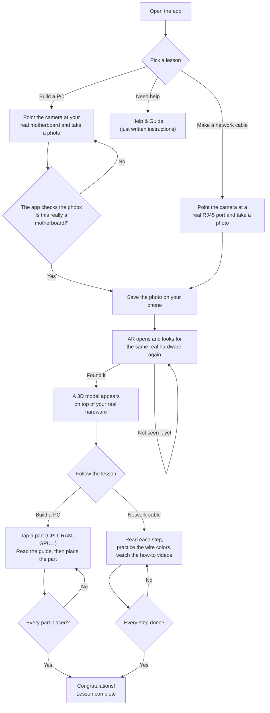

# ARplusCSS — How the App Works (simple data flow)

This shows what happens from the moment you open the app to the moment you
finish a lesson — in plain language.

**In short:** your phone photo *is* the marker. The app saves it, AR uses it to
recognize your real hardware, and then a 3D model plus guides appear on top of it.

**What stays on your phone**

- The photo you took (used every time you reopen that lesson).
- Where you placed the motherboard, so you don't have to line it up again.
- Network photos are deleted automatically when you leave that lesson — a fresh
  capture is always used.

**If you're a developer** (plain step → code)

| Step in the diagram | Where it lives |
| --- | --- |
| Take a photo / check it | `src/screens/MarkerCaptureScreen.jsx`, `src/utils/markerVerification.js` |
| Save the photo / position | `src/utils/markerStorage.js`, `src/utils/boardStateStorage.js` |
| AR opens & finds hardware | `src/screens/ARScreen.jsx`, `src/screens/ARNetworkScreen.jsx`, `src/ar/trackingTargets.js` |
| 3D model + taps + moves | `src/ar/MotherboardARSceneInner.jsx`, `src/ar/rj45/Rj45ARSceneInner.jsx` |
| Guides, buttons, progress | `src/ar/ARMotherboardScene.jsx`, `src/ar/rj45/ARRj45Scene.jsx`, `src/components/*` |
| All the data between UI & AR | `src/ar/arSceneBridge.js`, `src/ar/rj45/rj45SceneBridge.js` |
| Written instructions | `src/screens/HelpGuide.jsx`, `src/data/*` |
