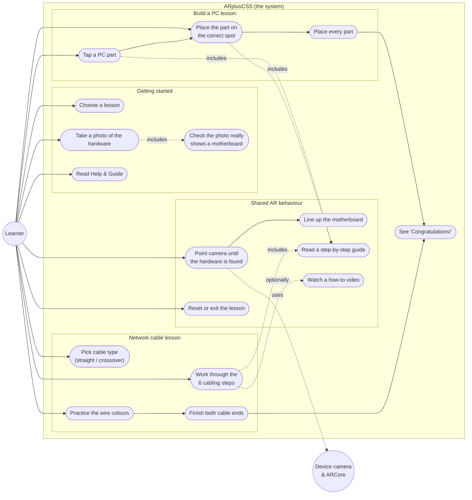

# ARplusCSS — Use Case Diagram

Who uses the system and what they can do. Plain language; render in any Mermaid
viewer (GitHub, VS Code, mermaid.live).

**Actors**

- **Learner** — the student using the app (the only person who interacts with it).
- **Device camera / ARCore** — a supporting actor the system relies on to recognise
  the real hardware. It is not a person.

**Legend**

- Solid arrow from an actor = "can do this".
- Dotted arrows = one use case **includes** another (always happens as part of it) or
  is **optional**.
- There is no login, no admin, and no other user role — everyone is a Learner.
